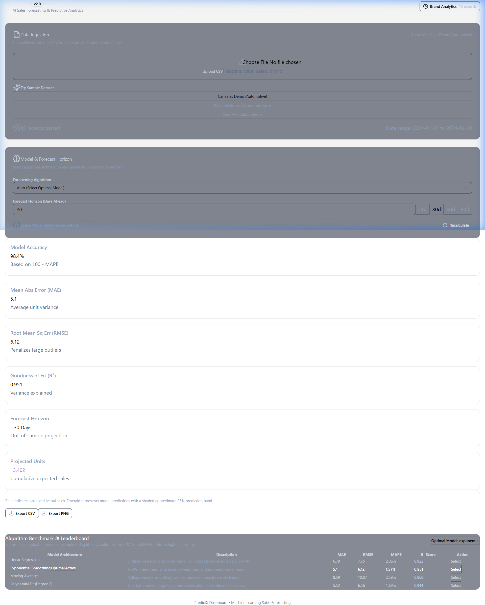
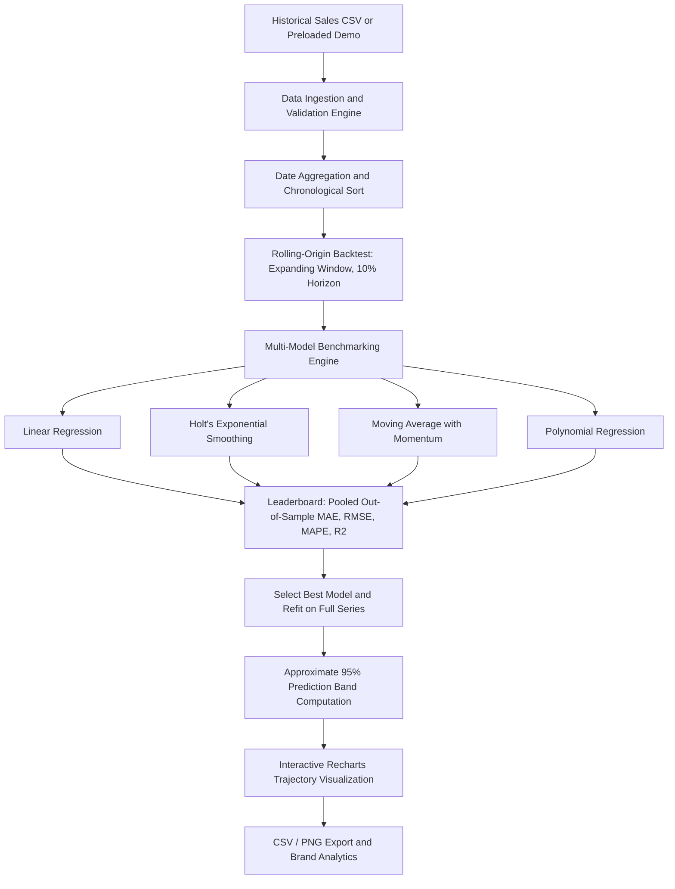

# PredictX — Sales Forecasting Dashboard

[](https://github.com/diyuworks/predictx/actions/workflows/ci.yml)
[](https://react.dev/)
[](https://vitejs.dev/)
[](https://vitest.dev/)
[](LICENSE)

**[Live demo -> <PASTE_VERCEL_URL>](<PASTE_VERCEL_URL>)** · runs entirely in your browser, no backend needed.



PredictX takes a CSV of historical sales, benchmarks four time-series models with a rolling-origin backtest, picks the best one on out-of-sample error, and projects the next 1–365 days with an approximate 95% prediction band. The four models are implemented from scratch in TypeScript (`src/lib/ml.ts`, no ML libraries) and covered by unit tests.

**Stack:** React 18 · Vite · Recharts · Radix UI · Vitest · Django REST Framework (optional backend)

---

## Table of Contents

- [Overview](#overview)
- [System Architecture](#system-architecture)
- [Key Features](#key-features)
- [Machine Learning Methodologies](#machine-learning-methodologies)
- [Model Evaluation and Backtesting](#model-evaluation-and-backtesting)
- [Sample Datasets](#sample-datasets)
- [Project Structure](#project-structure)
- [Installation and Setup](#installation-and-setup)
- [Data Ingestion Specifications](#data-ingestion-specifications)
- [Export and Reporting](#export-and-reporting)
- [What I Built and What I Learned](#what-i-built-and-what-i-learned)
- [Limitations and Design Notes](#limitations-and-design-notes)
- [Author and License](#author-and-license)

---

## Overview

Accurate demand forecasting is a common operational requirement in retail, inventory management, and resource planning. PredictX provides an accessible interface to evaluate and project sales trends:

1. Runs directly in the browser with client-side computation.
2. Benchmarks multiple time-series algorithms using a rolling-origin backtest instead of a single split.
3. Computes an approximate prediction band to communicate forecast uncertainty.
4. Breaks down category sales shares and generates exportable CSV and PNG summaries.

---

## System Architecture



---

## Key Features

- **Multi-Model Benchmark**: Trains and scores 4 forecasting algorithms using an expanding-window rolling-origin backtest.
- **Model Selection**: Selects the best-performing model based on minimal out-of-sample Mean Absolute Error (MAE), or allows manual selection.
- **Approximate 95% Prediction Band**: Visualizes an uncertainty band based on backtest RMSE that widens as the forecast horizon extends.
- **Preloaded Demo Datasets**: Instant 1-click access to automotive, consumer electronics, and SaaS subscription demo data.
- **Configurable Horizon**: Project between 1 and 365 days into the future with dynamic recalculation.
- **Brand Market Share Analytics**: Segment-level breakdowns, donut charts, and volume rankings on `/dashboard`.
- **Export Tools**: Download projected points and uncertainty bounds as CSV, or capture visual dashboard panels as PNG.
- **Optional Django REST Backend**: Provides atomic multi-row CSV upload, SQLite storage, and REST API endpoints.

---

## Machine Learning Methodologies

PredictX incorporates four distinct time-trend forecasting algorithms written from scratch:

### 1. Ordinary Least Squares Linear Regression
Fits a linear trend line through historical observations by minimizing the residual sum of squares:
$$\hat{y}_t = \beta_0 + \beta_1 t$$
Where:
$$\beta_1 = \frac{\sum_{i=1}^n (t_i - \bar{t})(y_i - \bar{y})}{\sum_{i=1}^n (t_i - \bar{t})^2}, \quad \beta_0 = \bar{y} - \beta_1 \bar{t}$$

### 2. Holt's Linear Exponential Smoothing
Adapts to trends using recursive level and slope smoothing parameters ($\alpha = 0.3$ and $\beta = 0.1$) with a fixed damping factor $\phi = 0.98$:
$$\text{Level: } L_t = \alpha y_t + (1 - \alpha)(L_{t-1} + b_{t-1})$$
$$\text{Trend: } b_t = \beta(L_t - L_{t-1}) + (1 - \beta)b_{t-1}$$
$$\text{Forecast: } \hat{y}_{t+h} = L_t + h \cdot b_t \cdot \phi^h$$
Note: This uses a simplified damped linear projection rather than the textbook geometric cumulative sum.

### 3. Moving Average with Momentum Extrapolation
Computes a rolling average baseline across a window $w = \min(5, \lfloor n/3 \rfloor)$ and extrapolates forward using the recent damped rate of change.

### 4. Polynomial Curve Fitting (Degree 2)
Solves a $3 \times 3$ system of normal equations via Gaussian elimination to fit quadratic curvature:
$$\hat{y}_t = a t^2 + b t + c$$
Captures accelerating growth or decelerating saturation, guarded by maximum value clamping.

### 5. Approximate 95% Prediction Band
The uncertainty standard deviation $\sigma$ is calculated from the pooled **out-of-sample errors** of the rolling-origin backtest:
$$\sigma = \sqrt{\frac{\sum_{i=1}^m (y_i - \hat{y}_i)^2}{m}}$$
To reflect increasing uncertainty over longer horizons, a heuristic widening multiplier $\sqrt{1 + 0.04 \cdot h}$ is applied:
$$\text{Margin} = 1.96 \cdot \sigma \cdot \sqrt{1 + 0.04 \cdot h}$$
$$\text{Lower Bound} = \max(0, \hat{y} - \text{Margin}), \quad \text{Upper Bound} = \hat{y} + \text{Margin}$$
This is an approximate heuristic band, not an exact closed-form statistical confidence interval.

---

## Model Evaluation and Backtesting

Evaluating small time series (30–45 points) on a single 80/20 train/test split is noisy because the test set contains only 6–9 points. 

PredictX uses an **expanding-window rolling-origin backtest**:
1. Starts training on a minimum window (60% of the series).
2. Predicts the next out-of-sample block with a horizon $h \approx \max(1, \lfloor 0.10 \cdot n \rfloor)$.
3. Expands the origin by $h$ points and repeats until the end of the series.
4. Pools all out-of-sample forecast errors across all folds to calculate benchmark metrics:

| Metric | Formula | Description |
| :--- | :--- | :--- |
| **MAE** | $\frac{1}{m}\sum \|y_i - \hat{y}_i\|$ | Mean Absolute Error. Primary benchmark criterion for model selection. |
| **RMSE** | $\sqrt{\frac{1}{m}\sum (y_i - \hat{y}_i)^2}$ | Root Mean Square Error; penalizes large prediction outliers. |
| **MAPE** | $\frac{100\%}{m}\sum \|\frac{y_i - \hat{y}_i}{y_i}\|$ | Mean Absolute Percentage Error; scale-independent error rate. |
| **R² Score** | $1 - \frac{\sum (y_i - \hat{y}_i)^2}{\sum (y_i - \bar{y})^2}$ | Coefficient of determination; measures variance explained by the model. |

---

## Sample Datasets

Sample datasets are located in the `sample_data/` directory and can also be loaded directly with 1 click in the user interface:

1. `sample_data/car_sales_demo.csv`: 45-day automotive sales records across Toyota, Honda, Tesla, BMW, and Ford.
2. `sample_data/retail_electronics_demo.csv`: 31-day consumer electronics retail data across Apple, Samsung, Sony, and Dell.

---

## Project Structure

```
predictx/
├── .github/
│   └── workflows/
│       └── ci.yml                  # GitHub Actions CI workflow (frontend + backend)
├── docs/
│   └── screenshots/                # Application screenshots
│       ├── dashboard.png           # Populated dashboard view
│       ├── dashboard-empty.png     # Initial state before data upload
│       ├── forecast-chart.png      # Forecast chart with actuals and predictions
│       ├── brand-analytics.png     # Brand market share donut chart
│       ├── model-configuration.png # Model configuration and upload card
│       └── model-results.png       # Metrics results panel
├── backend/                        # Optional Django REST API backend
│   ├── api/
│   │   ├── migrations/             # Database migrations
│   │   ├── models.py               # CarSalesData model
│   │   ├── serializers.py          # DRF serializers
│   │   ├── urls.py                 # API routes (/test, /upload-car-data, /car-data)
│   │   ├── views.py                # Atomic upload & list endpoints
│   │   └── tests.py                # Django test suite (7 tests)
│   ├── server/                     # Django project settings and URLs
│   ├── manage.py                   # Django CLI entrypoint
│   ├── requirements.txt            # Python dependencies
│   └── .env.example                # Template for environment variables
├── sample_data/                    # Ready-to-test CSV files
│   ├── car_sales_demo.csv
│   └── retail_electronics_demo.csv
├── src/                            # Frontend React Application
│   ├── components/
│   │   ├── ui/                     # Radix UI primitives
│   │   └── CarDataTable.tsx        # Backend database viewer modal
│   ├── lib/
│   │   ├── __tests__/              # Unit test suites (19 tests)
│   │   │   ├── ml.test.ts          # ML engine & backtest tests
│   │   │   └── csvParser.test.ts   # CSV parser & aggregation tests
│   │   ├── ml.ts                   # Forecasting algorithms & rolling-origin backtest
│   │   ├── sampleDatasets.ts       # Preloaded demo datasets
│   │   ├── csvParser.ts            # CSV parser & date aggregation helper
│   │   └── exportUtils.ts          # CSV and PNG report export helpers
│   ├── pages/
│   │   └── CarDashboard.tsx        # Brand distribution & market share analytics
│   ├── App.tsx                     # Main forecasting dashboard
│   ├── main.tsx                    # React DOM entry point
│   └── index.css                   # Global styles and pre-compiled Tailwind CSS
├── package.json                    # Node dependencies and scripts
├── vite.config.ts                  # Vite configuration (port 3000)
├── vercel.json                     # Vercel deployment and routing configuration
├── LICENSE                         # MIT License
└── README.md                       # Project documentation
```

---

## Installation and Setup

### Prerequisites

- Node.js (v18.0 or higher)
- npm (v9.0 or higher)
- Python (v3.9 or higher, optional for backend)

### 1. Frontend Setup

Clone the repository:
```bash
git clone https://github.com/diyuworks/predictx.git
cd predictx
```

Install dependencies:
```bash
npm install
```

Run unit tests:
```bash
npm test
```

Start the local development server:
```bash
npm run dev
```

Open the application at `http://localhost:3000`.

To create an optimized production build:
```bash
npm run build
```

### 2. Backend Setup (Optional)

In a separate terminal:
```bash
cd backend
python -m venv venv

# On Windows:
venv\Scripts\activate

# On macOS/Linux:
source venv/bin/activate

pip install -r requirements.txt
python manage.py migrate
python manage.py test
python manage.py runserver
```

The Django REST API runs at `http://127.0.0.1:8000/`.

---

## Data Ingestion Specifications

PredictX accepts CSV files with comma delimiters. The file must contain a header row with at least `date` and `sales` columns:

```csv
date,sales,brand
2024-01-01,142,Toyota
2024-01-02,156,Toyota
2024-01-03,138,Honda
```

- `date`: Valid date string parsed via `Date.parse()`.
- `sales`: Non-negative numeric sales volume or revenue figure. Rows with invalid or negative values are automatically filtered out.
- `brand` (optional): Category label used for segment market share breakdowns on `/dashboard`. Defaults to `"General"` if omitted.
- **Date Aggregation**: Multiple rows sharing the same date are summed into a single daily total before forecasting to ensure an uncorrupted chronological time index.

---

## Export and Reporting

- **Forecast CSV Export**: Downloads a CSV containing date, actual sales, predicted values, and approximate 95% lower/upper bounds.
- **High-Resolution PNG Capture**: Captures dashboard charts and analytics panels as PNG images using `html2canvas`.
- **Brand Analytics CSV**: Exports market share breakdowns and volume rankings.

---

## What I Built and What I Learned

- Built the time-series forecasting algorithms (linear regression, Holt's linear exponential smoothing with damped trend, moving average, and quadratic polynomial fit via Gaussian elimination) from scratch in TypeScript with zero third-party ML dependencies.
- Replaced a standard single 80/20 train/test split with an expanding-window rolling-origin backtest after finding that evaluating small time-series (30–45 points) on a tiny holdout set caused high variance and noisy model selection.
- Structured an end-to-end data validation and date-aggregation pipeline to handle edge cases like duplicated dates, quoted CSV fields, missing columns, and non-numeric values before feeding the models.
- Built automated Vitest test suites (19 unit tests) and GitHub Actions CI to verify both the mathematical correctness of the models and the robustness of data parsing on every commit.

---

## Limitations and Design Notes

Written down on purpose, so nobody has to guess what this project does and doesn't claim.

- **Prediction band is approximate.** It is `1.96 × RMSE × sqrt(1 + 0.04·h)`, where RMSE comes from out-of-sample backtest errors and the horizon-widening factor is a heuristic. It is not a closed-form statistical prediction interval and its coverage has not been empirically validated.
- **Model selection uses a rolling-origin backtest** (expanding window, horizon ≈ 10% of the series). With 30–45 daily points, differences between models can be within noise; treat "best model" as "best on this backtest".
- **Models are simple trend models.** No weekly/annual seasonality, holidays or external regressors. Holt damping uses a fixed φ = 0.98 and the forecast is `L + h·b·φ^h` (a simplified damped trend), not the textbook cumulative-sum form.
- **One series per upload.** Rows sharing a date are summed into one daily total before forecasting; the `brand` column is used only for the Brand Analytics page.
- **Demo datasets are synthetic**, generated for demonstration.
- **Backend is optional** and not used by the hosted demo; it stores uploaded rows in SQLite and exposes `/api/upload-car-data/` and `/api/car-data/`.

---

## Author and License

Developed by **Diya Malviya**.  
GitHub: [https://github.com/diyuworks](https://github.com/diyuworks)

This project is licensed under the MIT License. See the [LICENSE](LICENSE) file for details.
